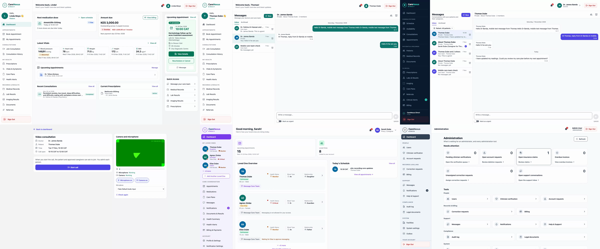

# CareNexus: Cyprian core updates

[Watch the recording](carenexus-cyprian-core-updates.mp4) — 4 minutes, 1600 × 1000, 25 fps, H.264 MP4. Silent browser capture with six chapters and optional English captions. The subtitle text is also available in `cyprian-core-updates.srt`.

Recorded on 17 November 2026 from the real local web app and Spring Boot backend. Source: `cyprian/web-backend-launch-scope`, commit `8ed3e82`, covered by [application PR #7](https://github.com/costanho/Carenexus/pull/7). This recording package makes no application changes and does not merge that PR. The source branch contains the earlier Cyprian messaging, video and UI improvements plus the launch functionality. Later doctor-dashboard changes on `main` are outside this recording.

| Start | Walkthrough |
| --- | --- |
| 0:00 | Patient: dashboard, vitals, care plan and local payment |
| 1:06 | Patient: messaging and caregiver permissions |
| 1:36 | Doctor: messages, availability, prescriptions and clinical alerts |
| 2:23 | Video consultation: synthetic camera, real local LiveKit call |
| 2:54 | Caregiver: linked patients and shared records |
| 3:23 | Administrator: users, billing, audit trail and settings |

The payment uses the local gateway simulator; no money moves. The video call connects two real browser sessions through local LiveKit, with synthetic camera and microphone input. Clinical alerts are the application's rule-based screening, not a clinical diagnosis. Native mobile builds are outside this web recording.

## Recording environment

The Expo web export was served at `http://localhost:8081`; the Spring Boot API ran at `http://localhost:9000` with the `local` profile and its rate limit disabled for the demo. PostgreSQL and LiveKit ran in Docker. The walkthrough uses published development seed accounts across four roles: patient, doctor, caregiver and administrator.

For local setup and development logins, see the [README for the recorded revision](https://github.com/costanho/Carenexus/blob/8ed3e82/README.md). The URLs above describe the recording environment; they require the local services to be started.

## Verification and local demo data

The web export succeeded. [Screen verification](verification.json) records 21 screens across five accounts with no observed API/page errors or rendering artifacts. [Backend verification](backend-verification.json) independently confirms the saved heart-rate reading, paid demo invoice, ended call and messages visible to both accounts. These are focused walkthrough checks, not a complete regression suite.

[Delivery verification](delivery-verification.json) records a successful full video decode, resolution, codec and chapter metadata. [Recording metadata](recording.json) provides exact scene timings and the checks made during capture.

The recording added Linda's 72 bpm reading (`e2e-recording Morning heart rate`), settled demo invoice `INV-2026-900003` through simulation, sent one patient message and one doctor reply, and created/ended video consultation 720. These changes remain in the local development database. Existing data was not reset. Application source files and existing deployment edits were preserved.

Only the final recording, preview, captions and verification evidence are versioned here. Raw captures, intermediate media, browser logs and capture tooling are excluded by this directory's `.gitignore`.
